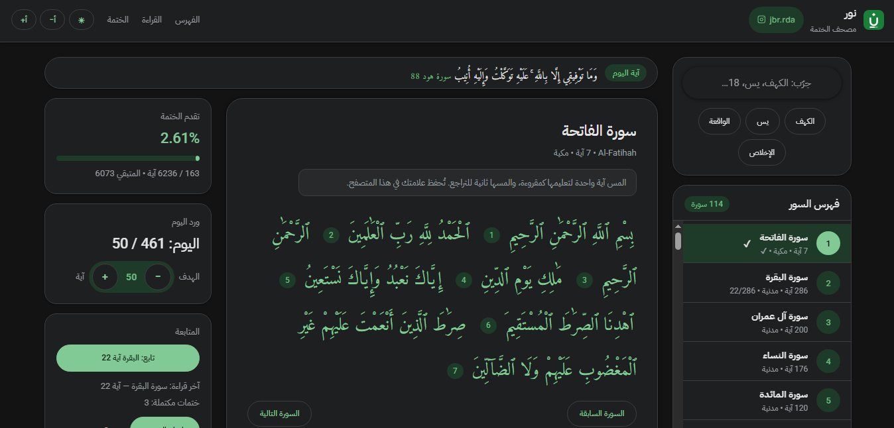

# Noor — Khatma Mushaf

[](https://jabar-reda.github.io/quran-app/)
[](LICENSE)
[](https://jabar-reda.github.io/quran-app/)
[](#running-locally)
[](#privacy-and-data)
[](https://instagram.com/jbr.rda)

> An in-browser mushaf that helps you complete the Quran verse by verse, with local-only progress and no account.
>
> **Try it now: [jabar-reda.github.io/quran-app](https://jabar-reda.github.io/quran-app/) — developer: [@jbr.rda](https://instagram.com/jbr.rda)**

## Preview



## Features

- App layout: sidebar (search + 114-surah index) + reading area — the reader is in front of you as soon as the page opens.
- Verse of the day: a small strip above the reader, rotating daily from a local list.
- 114-surah index with sidebar search by Arabic name, English name, or number (Arabic search tolerates hamzas and ta-marbuta: «ابراهيم» finds «إبراهيم»; numbers accept Eastern Arabic digits and leading zeros: «١٨» and «018» find Al-Kahf).
- Uthmani-script reading in the Amiri font, with font enlarge/shrink (أ+ / أ−).
- Tap a verse to mark it read; tap again to undo.
- Khatma card beside the reader: percentage, progress bar, daily portion with adjustable goal (default 20 verses), continue button, last read, completed khatmas.
- The "Continue" button returns you to your last verse; "Complete surah" (disabled until a surah is open) shows a confirmation with the unmarked count and its effect on today's portion; the red "New khatma" button opens a site-styled confirmation that states the shortfall explicitly and requires checking an acknowledgment box to count a khatma (never automatic).
- A custom congratulations dialog on khatma completion, and a footer button showing the locally saved surah count that opens the status bar on demand.
- Automatic night mode from the OS with a toggle (☾/☀) saved in the browser.
- Same tap/click behavior on phone and desktop, with screen-reader support.
- On phones: slim single-row header (font size buttons move into the reader head) plus a sticky tracking strip (today/goal + percentage over a green progress fill) that follows you while reading.
- Faster cold start: the service worker caches only the critical shell at install, and background surah preloading starts 2s after page load.
- 4 surahs work offline immediately (Al-Fatiha, Al-Ikhlas, Al-Falaq, An-Nas); the rest load automatically in the background after opening the page (max 1MB/s) and are saved after first load.

## Usage

1. Search for a surah in the sidebar (e.g. Al-Kahf, Ya-Sin, 18) or pick from the index.
2. Tap any verse to mark it read; tap it again to undo.
3. Follow your percentage in the "Khatma progress" card and today's portion against your goal.
4. Use "Continue reading" to return to the last verse where you stopped.
5. When you finish a whole surah you can press "Complete surah" instead of marking every verse.

## Running locally

No build needed. From the repo root, serve statically, then open the page:

```bash
python3 -m http.server 8000
# open http://localhost:8000
```

Note: opening `index.html` directly over `file://` may block fetching `data/surahs.json` in some browsers, so a local server is preferred. The service worker (`sw.js`) also registers only over `http(s)` and is skipped silently on `file://`.

Requirements: only a modern browser (no dependencies, no build).

## Install as app (PWA / APK)

The site is an installable PWA (manifest + service worker + icons): open the published HTTPS URL in Chrome/Edge on Android and use "Add to Home screen" / "Install app".

To get an `APK` file: publish the site, then package the URL with [PWABuilder](https://www.pwabuilder.com) (free, no ads) — it outputs `APK`/`AAB` from the same code, so later site updates reach app users automatically with no new build.

- App storage is separate from the browser: progress saved in the browser does not transfer into the installed app (and vice versa) — each starts its own `localStorage`.
- If you change any file listed in `CORE` inside `sw.js`, bump `SW_CACHE` (e.g. `noor-v2`) so users receive the update.

## Project structure

```
index.html            Layout: topbar + sidebar (search + index) + reading area (daily verse + reader + khatma card)
manifest.webmanifest  PWA identity (name, colors, icons) — makes the site installable + APK-ready via PWABuilder
sw.js                 Service worker: caches the app shell for offline + installability (bump `SW_CACHE` when core files change)
assets/icons/         PWA icons rasterized from the C1 logo: icon-192.png, icon-512.png, maskable-512.png
404.html              Not-found page in site identity (links home to /quran-app/)
css/style.css         Green theme and grid (.app) + night mode (data-theme)
js/app.js             Logic: state, index, loading, marking, stats, daily verse, theme
js/offline-surahs.js  4 embedded surahs for offline use
data/surahs.json      114-surah index (number, name, English, verse count, type) — total 6236
data/daily.json       Verse of the day: ~30 verses ({text, ref}) — picked by day of year
assets/logo/          Logo (adopted concept C1) + favicon
```

## How it works in brief

- State lives in `localStorage` under `quran_tracker_v1`: `surah:ayah` keys for read verses (value = marking date `YYYY-MM-DD`), last read, daily log, goal, font size, theme (`null` = automatic).
- Surah text lives in `localStorage` under the `surah_cache_` prefix after first fetch from `api.alquran.cloud`.
- Percentage = read count ÷ 6236.
- The daily verse is picked deterministically from `data/daily.json` (`dayOfYear % verse count`).
- "New khatma" resets progress (counting a completed khatma requires explicitly checking an acknowledgment box); at 6236 verses the completion message appears and resets automatically.

## Privacy and data

All data stays in your browser alone. No accounts and nothing sent to third parties except fetching surah text from the API the first time.

- Clearing browser data deletes your progress and saved surahs.
- No progress export/import.

## FAQ

- **Where is my progress if I switch devices?** Progress is local per browser and does not move to another device automatically.
- **Why do some surahs not work offline?** Only Al-Fatiha, Al-Ikhlas, Al-Falaq, and An-Nas are embedded. Other surahs are saved after their first load while online.
- **How do I reset my progress?** In the "Follow-up" card press "New khatma" and confirm.
- **How do I change my daily goal?** Use the −/+ buttons in the "Today's portion" card (1–500), or focus the number and use the keyboard arrows.
- **How do I know the connection status?** A badge appears only when offline ("offline — saved surahs only") and hides when online.

## Sources and thanks

- Surah text: [api.alquran.cloud](https://api.alquran.cloud) (Uthmani script, `quran-uthmani` edition).
- Fonts: [Amiri Quran](https://fonts.google.com/specimen/Amiri+Quran) and IBM Plex Sans Arabic via Google Fonts.

## Logo

Concept C1 "Khatma Noon" (`assets/logo/noor-c1-icon-color.svg` in the header and `assets/logo/favicon.svg` for the tab).

## Contact

Developer on Instagram: [@jbr.rda](https://instagram.com/jbr.rda)

## License

MIT — see `LICENSE`.
