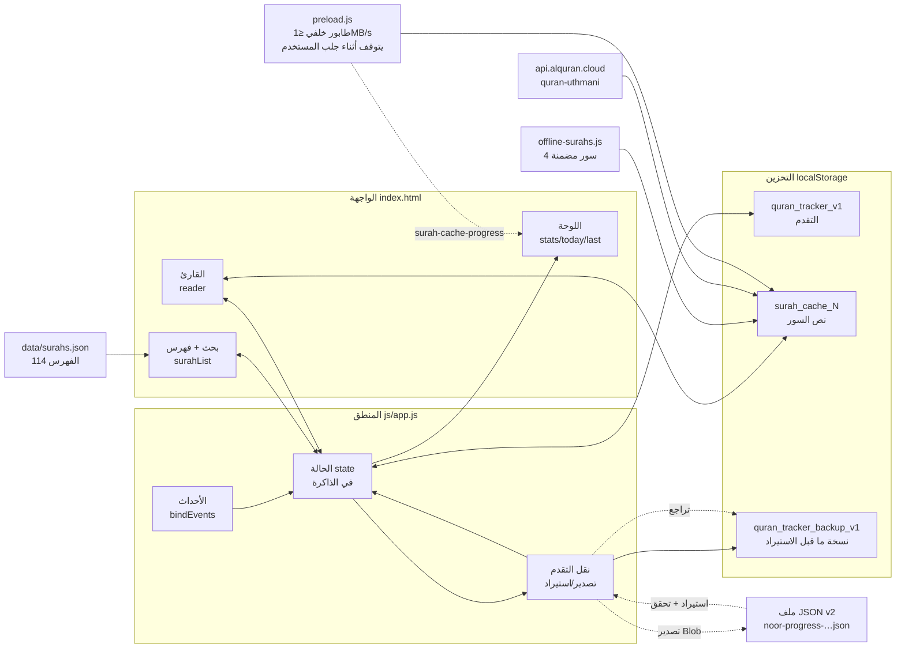
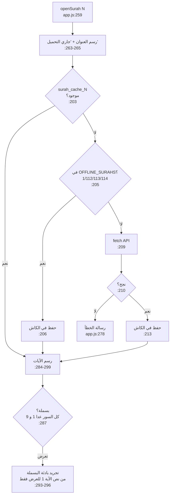
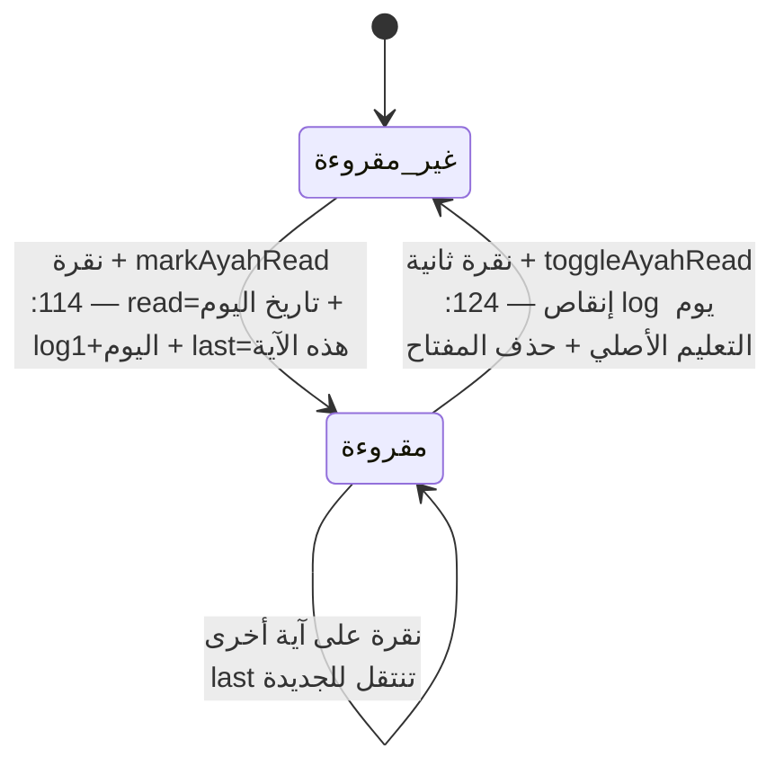
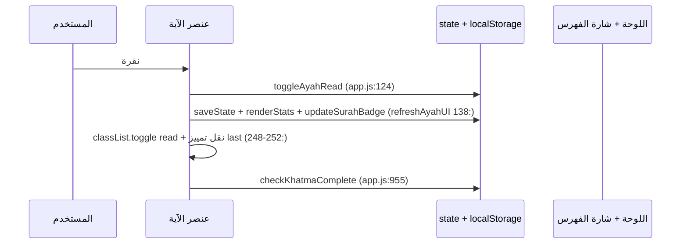
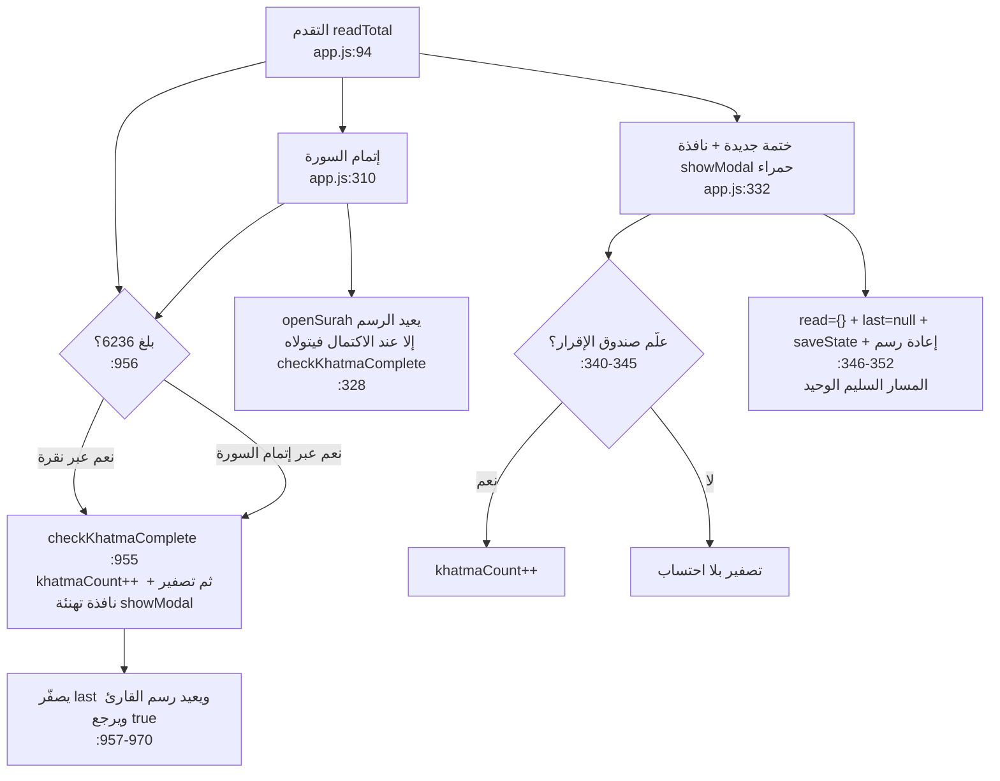
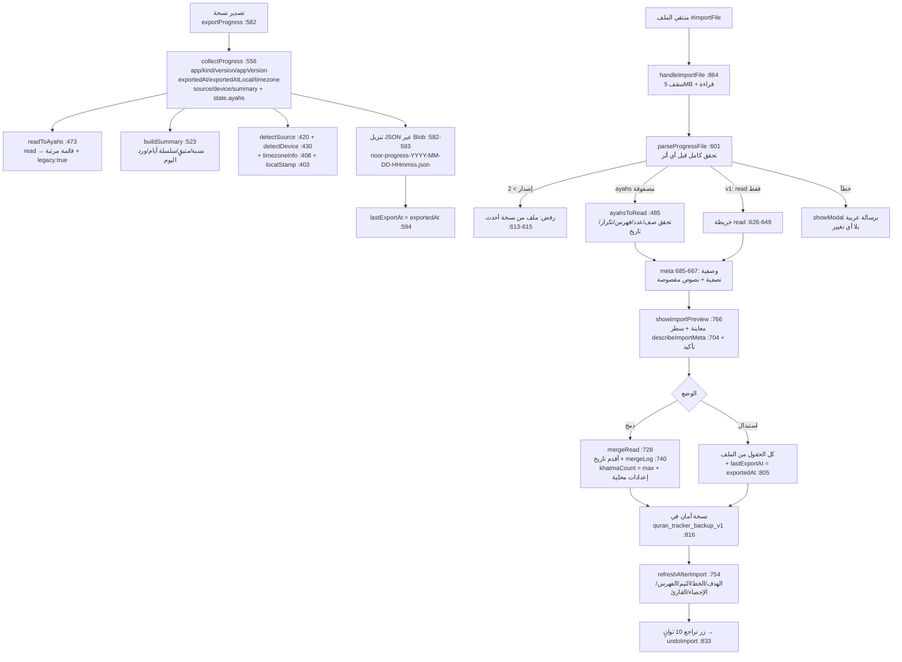

# خريطة الكود البصرية — «نور · مصحف الختمة»

> كيف يعمل الكود فعلًا (وليس كيف يُفترض). الملف مرجع بصري + سجل المشاكل المنطقية المؤكدة.
> أرقام الأسطر حسب `js/app.js` الحالي (1251 سطرًا). الرسومات بصيغة Mermaid وتُعرض على GitHub مباشرة.

## 1. الصورة الكاملة: من أين تأتي البيانات وإلى أين تذهب

القاعدة الذهبية: **كل تغيير في `state` يُحفظ فورًا (`saveState`) ثم تُحدَّث اللوحة (`renderStats`)** — ما عدا مسارًا واحدًا فيه خلل (انظر مشكلة A).

## 2. فتح سورة: شلال التحميل + السباق الخفي

✅ **السباق محمي:** حارس `if (currentSurah !== number) return` موجود بعد `await` في مسار الفشل (سطر 277) وبعد النجاح قبل الرسم (سطر 282). لذلك نقرة سريعة «البقرة ثم الإخلاص» لا تعرض نص البقرة تحت عنوان الإخلاص.

## 3. تعليم آية: آلة الحالة + محاسبة اليوم

الفكرة الذكية: القيمة المخزنة **تاريخ التعليم** لا `true`، فيُخصم التراجع من يومه الصحيح لا من اليوم الحالي.
القيم القديمة `true` (قبل التحديث) تعمل كـ truthy لكن تراجعها لا يُنقص أي يوم — سلوك مقصود وموثق (`toggleAyahRead` سطر 129).

## 4. دورة الختمة: المسارات الثلاثة للتصفير

## 5. خريطة التخزين

| المفتاح | الكاتب | القارئ | ملاحظة |
|---|---|---|---|
| `quran_tracker_v1.read` | `markAyahRead :118` / `toggleAyahRead :129-131` | `readTotal :95` / `readCountOf :101` | القيمة تاريخ `YYYY-MM-DD` (قديمًا `true`) |
| `...log` | `markAyahRead :120` / `toggleAyahRead :129` | `renderStats :936` | يُخصم من يوم التعليم الأصلي |
| `...last` | `markAyahRead :119` / تصفير جزئي `:131` `:347` `:959` | `createAyahElement :235` / `renderStats :938-940` / `init :1242` | يُصفَّر في الاكتمال والتصفير |
| `...theme` | `toggleTheme :910` | `currentTheme :892-894` + سكربت `index.html:10` | `null` = تلقائي |
| `...lastExportAt` | `exportProgress :594` / استبدال `applyImport :805` | `renderTransferStatus :397` | ISO لآخر نسخة؛ لا يتغير بالدمج |
| `quran_tracker_backup_v1` | `applyImport :816` | `undoImport :836` | نسخة أمان قبل الاستيراد، تُحذف بعد التراجع `:847` |
| `surah_cache_N` | `saveSurahCache :89` | `getCachedAyahs :80` | يُسقط حقل `name` الزائد — سليم |

## 6. المشاكل المنطقية — سجل الإصلاح (رُوجعت 2026-10-13، وأُصلحت جميعها)

| # | الخطورة | الموقع | المشكلة | الإصلاح المطبق |
|---|---|---|---|---|
| A1 | 🔴 عالية | `js/app.js:955-970` | `checkKhatmaComplete` كان يُصفّر دون إعادة رسم القارئ (يبقى أخضر وحالة فارغة) | ✅ يعيد `openSurah(currentSurah)` ويرجع `true`؛ و`completeCurrentSurah` يتخطى رسمه الخاص عندها (`:328`) |
| A2 | 🔴 عالية | `js/app.js:959` | `last` لم يُصفَّر عند الختمة التلقائية | ✅ `state.last = null` |
| B | 🟠 متوسطة | `js/app.js:277` و`:282` | سباق النقرات السريعة (نص سورة تحت عنوان أخرى) | ✅ حارس `currentSurah !== number` بعد كل `await` |
| C | 🟠 متوسطة | `js/app.js:923-925` + `css/style.css:207` و`:267` | `style.fontSize` المباشر كان يقتل `clamp()` على الجوال | ✅ متغير `--reader-size` مع احتياطي مرن |
| D | 🟡 متوسطة UX | `js/app.js:155-156` | البحث العربي حرفي (ابراهيم ≠ إبراهيم) | ✅ `normalizeArabic` للطرفين (`surahMatches :173`) |
| E | 🟢 منخفضة | `js/app.js:1136` | الهدف بلا سقف فعلي رغم `max=500` | ✅ `Math.min(500, ...)` مع رد القيمة للحقل |
| F | 🟢 منخفضة | `js/app.js:934-935` | ‏6236 مكررة يدويًا في HTML | ✅ `aria-valuemax` تُضبط من `TOTAL_AYAS` عند كل رسم |
| G | 🟢 منخفضة | `js/app.js:9` | عتبة `−10` رقم سحري | ✅ ثابت مسمى `KHATMA_RESET_MARGIN` مع تعليل (المنطق الفعلي إقرار صريح في `resetKhatma`) |

ما **ليس** مشكلة (فُحص وتبيّن سليمًا): محاسبة `log` بالخصم من يوم التعليم الأصلي (`:129`)، إسقاط البسملة للسورتين 1 و9 (`:287`)، شكل كاش السور (`:88-91`)، عدم إبراز سورة مُفلترة خارج البحث (محمي بـ `if (!el)` في `:148`)، وعدم وجود ثغرة XSS (لا يُحقن أي مدخل مستخدم في `innerHTML`).

## 7. كيف تقرأ هذا الملف مع الكود

1. ابدأ بالرسم 1 (التدفق العام)، ثم 2 (فتح سورة) مع `openSurah` مفتوحة.
2. تتبع الرسم 3 مع `toggleAyahRead` — كل سهم يقابل سطرًا.
3. الرسم 4 هو خريطة الختمة: كل مسار تصفير وما ينقصه.
4. جدول §6 هو سجل الإصلاح — كل البنود مطبقة وموثقة بمواقعها.

## 8. نقل التقدم: تصدير/استيراد محلي (v2)

قسم مستقل في `js/app.js:355-888` بلا أي شبكة: الملف يُنشئه المتصفح ويُقرأ فيه فقط.
الصيغة الكاملة في `docs/PROGRESS-FILE.md`.

- **v2 بلا `read`:** ملف v2 يحمل `state.ayahs` قائمة `[{surah, ayah, date}]` مرتبة بالسورة ثم الآية. `read` يبقى شكل التخزين المحلي فقط؛ إن كانت `ayahs` مصفوفة في الملف (داخل `state` أو في الجذر) فهي المرجع ويُتجاهل أي `read` مكرر (`:618-623`).
- **توافق v1:** غياب `ayahs` يعني خريطة `read` بصيغة v1 (`"سورة:آية" → تاريخ | true`)، وتُقبل `true` كما هي (`:642-644`). القيمة `true` في v2 تُصدَّر `{date:null, legacy:true}` (`:478`) وتُستورد `true` مجددًا (`:510-512`).
- **رفض الأحدث:** `Number(root.version) > PROGRESS_FORMAT` تُرفض برسالة «هذا الملف من نسخة أحدث من التطبيق» (`:613-615`) — لا محاولة تفسير صامت.
- **قاعدة الحماية:** `parseProgressFile` لا يبني الحالة بـ spread من الملف؛ `ayahsToRead` تتحقق من كل عنصر (كائن، أعداد صحيحة حقيقية، فهرس، لا تكرار، تاريخ حقيقي لا يتجاوز الغد) وترفض الملف كاملًا عند أول خطأ. وv1 تتحقق من كل مفتاح (`^\d{1,3}:\d{1,3}$`) وكل تاريخ.
- **الوصفي لا يُستورد:** `appVersion` و`exportedAt` و`exportedAtLocal` و`timezone` و`source` و`device` و`summary` للعرض فقط. يُبنى منها `meta` مقصوص (`:667-685`) لسطر المعاينة، ولا تدخل `incoming` (`:687-700`).
- **الدمج آمن للتكرار:** إعادة استيراد الملف نفسه لا تضاعف العدّاد؛ `mergeLog` (سطر 740) يعيد حساب الأيام من تواريخ `read` ثم يأخذ `max` مع المحفوظ والمستورد، فلا ينقص سجل ختمة سابقة.
- **الاستبدال ليس نسخًا أعمى:** `log` يُعاد حسابه من `read` ثم `max` مع `log` الملف (`:799`)، و`lastExportAt` يأتي من `exportedAt` الملف (`:805`).
- **لا ختمة وهمية:** لا يُستدعى `checkKhatmaComplete` بعد الاستيراد لأنه ليس قراءة جديدة.
- **زر التراجع:** يظهر 10 ثوانٍ (`:827-829`)، ويستعيد الحالة السابقة من `quran_tracker_backup_v1`؛ النسخة تبقى بعد انتهاء المهلة حتى استيراد تالٍ. القاعدة `.transfer-undo[hidden]` في `css/style.css:344` ضرورية لأن `.link-quiet` يفرض `display:inline-flex` (`css/style.css:152`).
