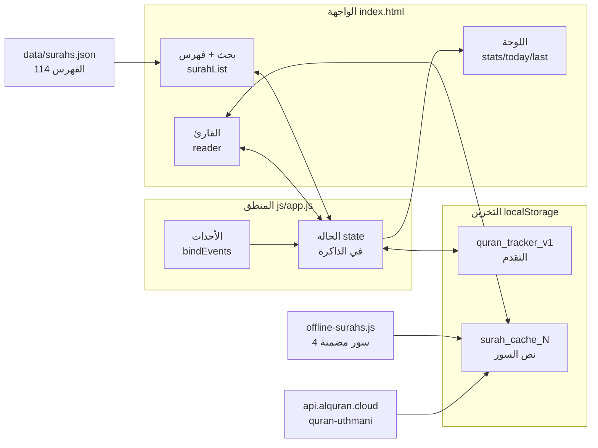
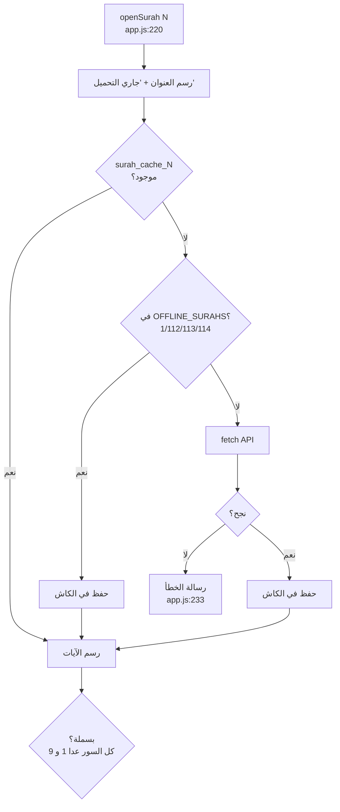
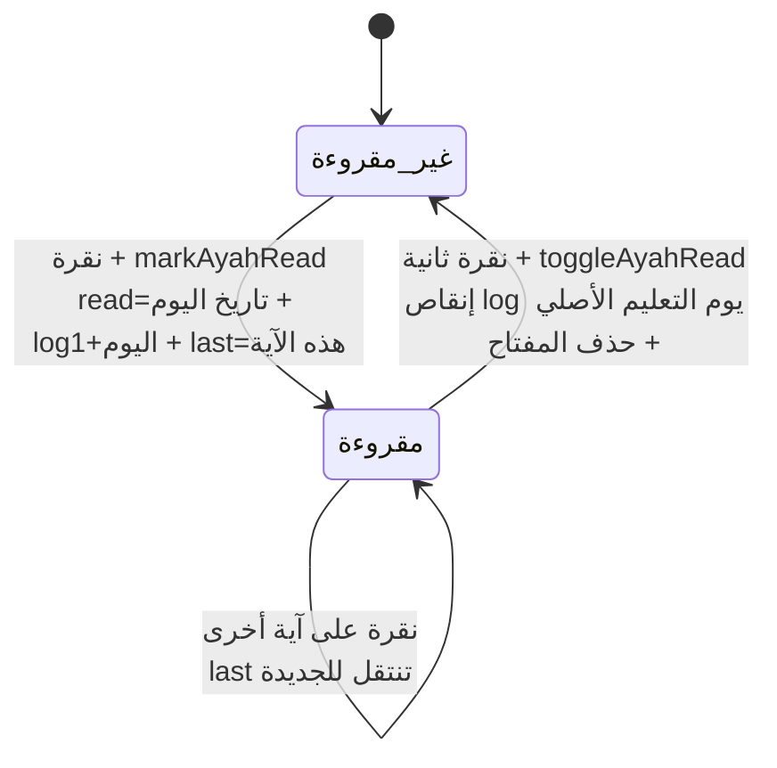
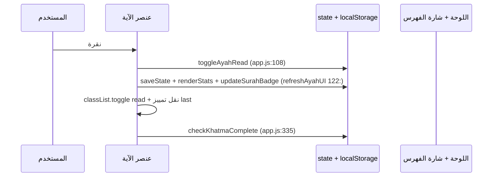
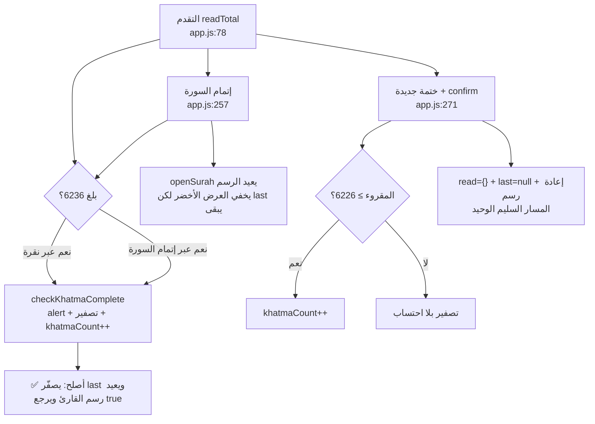

# خريطة الكود البصرية — «نور · مصحف الختمة»

> كيف يعمل الكود فعلًا (وليس كيف يُفترض). الملف مرجع بصري + سجل المشاكل المنطقية المؤكدة.
> أرقام الأسطر حسب `js/app.js` الحالي (~404 سطرًا). الرسومات بصيغة Mermaid وتُعرض على GitHub مباشرة.

## 1. الصورة الكاملة: من أين تأتي البيانات وإلى أين تذهب

القاعدة الذهبية: **كل تغيير في `state` يُحفظ فورًا (`saveState`) ثم تُحدَّث اللوحة (`renderStats`)** — ما عدا مسارًا واحدًا فيه خلل (انظر مشكلة A).

## 2. فتح سورة: شلال التحميل + السباق الخفي

⚠️ **السباق:** بين `await` (سطر 231) والرسم (سطر 237) لا يوجد حارس `if (currentSurah !== number) return`.
نقرة سريعة «البقرة (بطيئة شبكيًا) ثم الإخلاص (فورية)» قد تعرض نص البقرة تحت عنوان الإخلاص. انظر مشكلة B.

## 3. تعليم آية: آلة الحالة + محاسبة اليوم

الفكرة الذكية: القيمة المخزنة **تاريخ التعليم** لا `true`، فيُخصم التراجع من يومه الصحيح لا من اليوم الحالي.
القيم القديمة `true` (قبل التحديث) تعمل كـ truthy لكن تراجعها لا يُنقص أي يوم — سلوك مقصود وموثق.

## 4. دورة الختمة: المسارات الثلاثة للتصفير

## 5. خريطة التخزين

| المفتاح | الكاتب | القارئ | ملاحظة |
|---|---|---|---|
| `quran_tracker_v1.read` | `markAyahRead :102` / `toggleAyahRead :108-114` | `readTotal :78` / `readCountOf :83` | القيمة تاريخ `YYYY-MM-DD` (قديمًا `true`) |
| `...log` | `markAyahRead :104` / `toggleAyahRead :113` | `renderStats :323` | يُخصم من يوم التعليم الأصلي |
| `...last` | `markAyahRead :103` / تصفير جزئي `:115` `:275` | `renderStats :325` / `init :401` | ⚠️ لا يُصفَّر في `checkKhatmaComplete` |
| `...theme` | `toggleTheme :303` | `currentTheme :286` + سكربت `index.html:9` | `null` = تلقائي |
| `surah_cache_N` | `saveSurahCache :73` | `getCachedAyahs :63` | يُسقط حقل `name` الزائد — سليم |

## 6. المشاكل المنطقية — سجل الإصلاح (رُوجعت 2026-10-13، وأُصلحت جميعها)

| # | الخطورة | الموقع | المشكلة | الإصلاح المطبق |
|---|---|---|---|---|
| A1 | 🔴 عالية | `js/app.js:349-360` | `checkKhatmaComplete` كان يُصفّر دون إعادة رسم القارئ (يبقى أخضر وحالة فارغة) | ✅ يعيد `openSurah(currentSurah)` ويرجع `true`؛ و`completeCurrentSurah` يتخطى رسمه الخاص عندها (`:275`) |
| A2 | 🔴 عالية | `js/app.js:354` | `last` لم يُصفَّر عند الختمة التلقائية | ✅ `state.last = null` |
| B | 🟠 متوسطة | `js/app.js:240` و`:244` | سباق النقرات السريعة (نص سورة تحت عنوان أخرى) | ✅ حارس `currentSurah !== number` بعد كل `await` |
| C | 🟠 متوسطة | `js/app.js:324-326` + `css/style.css:120` و`:150` | `style.fontSize` المباشر كان يقتل `clamp()` على الجوال | ✅ متغير `--reader-size` مع احتياطي مرن |
| D | 🟡 متوسطة UX | `js/app.js:141-154` | البحث العربي حرفي (ابراهيم ≠ إبراهيم) | ✅ `normalizeArabic` للطرفين |
| E | 🟢 منخفضة | `js/app.js:366` | الهدف بلا سقف فعلي رغم `max=500` | ✅ `Math.min(500, ...)` مع رد القيمة للحقل |
| F | 🟢 منخفضة | `js/app.js:336` | ‏6236 مكررة يدويًا في HTML | ✅ `aria-valuemax` تُضبط من `TOTAL_AYAS` عند كل رسم |
| G | 🟢 منخفضة | `js/app.js:9` | عتبة `−10` رقم سحري | ✅ ثابت مسمى `KHATMA_RESET_MARGIN` مع تعليل |

ما **ليس** مشكلة (فُحص وتبيّن سليمًا): محاسبة `log` بالخصم من يوم التعليم الأصلي، إسقاط البسملة للسورتين 1 و9، شكل كاش السور، عدم إبراز سورة مُفلترة خارج البحث (محمي بـ `if (!el)` في `:131`)، وعدم وجود ثغرة XSS (لا يُحقن أي مدخل مستخدم في `innerHTML`).

## 7. كيف تقرأ هذا الملف مع الكود

1. ابدأ بالرسم 1 (التدفق العام)، ثم 2 (فتح سورة) مع `openSurah` مفتوحة.
2. تتبع الرسم 3 مع `toggleAyahRead` — كل سهم يقابل سطرًا.
3. الرسم 4 هو خريطة الخلل: كل مسار تصفير وما ينقصه.
4. جدول §6 هو سجل الإصلاح — كل البنود مطبقة وموثقة بمواقعها.
