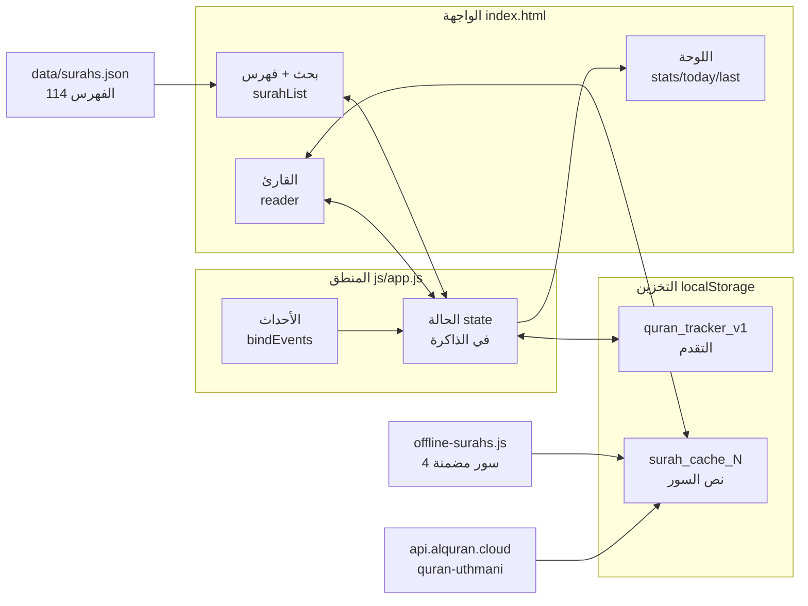
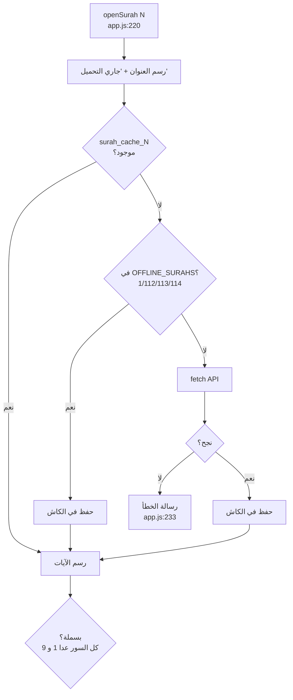
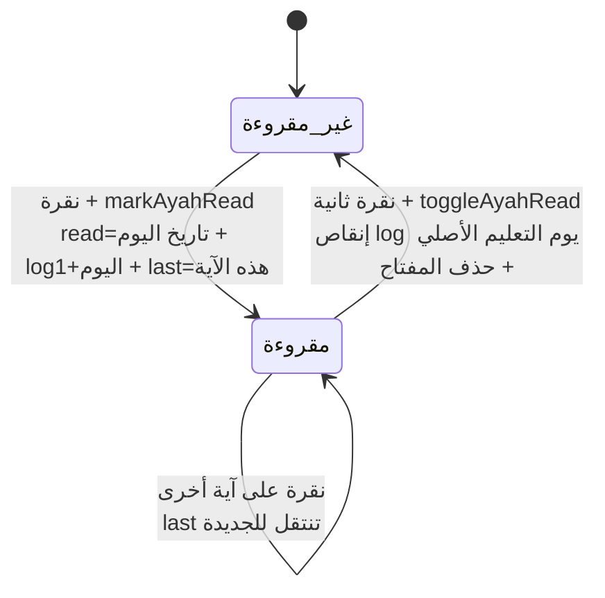
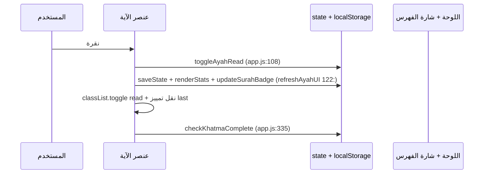
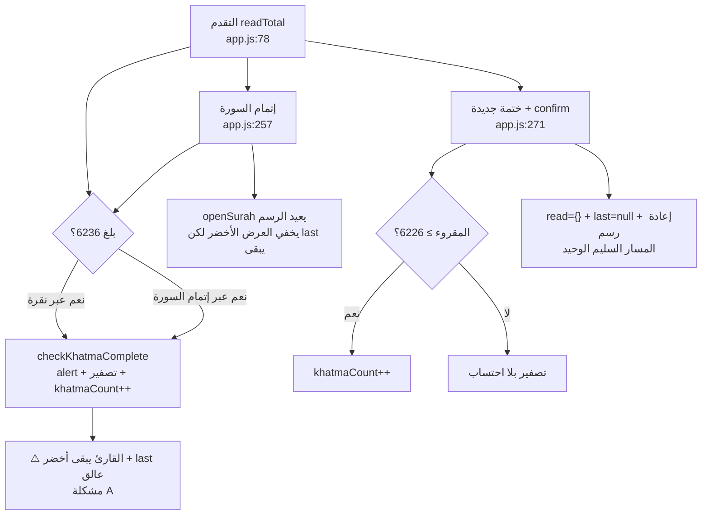

# خريطة الكود البصرية — «نور · مصحف الختمة»

> كيف يعمل الكود فعلًا (وليس كيف يُفترض). الملف مرجع بصري + سجل المشاكل المنطقية المؤكدة.
> أرقام الأسطر حسب `js/app.js` الحالي (~404 سطرًا). الرسومات بصيغة Mermaid وتُعرض على GitHub مباشرة.

## 1. الصورة الكاملة: من أين تأتي البيانات وإلى أين تذهب

القاعدة الذهبية: **كل تغيير في `state` يُحفظ فورًا (`saveState`) ثم تُحدَّث اللوحة (`renderStats`)** — ما عدا مسارًا واحدًا فيه خلل (انظر مشكلة A).

## 2. فتح سورة: شلال التحميل + السباق الخفي

⚠️ **السباق:** بين `await` (سطر 231) والرسم (سطر 237) لا يوجد حارس `if (currentSurah !== number) return`.
نقرة سريعة «البقرة (بطيئة شبكيًا) ثم الإخلاص (فورية)» قد تعرض نص البقرة تحت عنوان الإخلاص. انظر مشكلة B.

## 3. تعليم آية: آلة الحالة + محاسبة اليوم

الفكرة الذكية: القيمة المخزنة **تاريخ التعليم** لا `true`، فيُخصم التراجع من يومه الصحيح لا من اليوم الحالي.
القيم القديمة `true` (قبل التحديث) تعمل كـ truthy لكن تراجعها لا يُنقص أي يوم — سلوك مقصود وموثق.

## 4. دورة الختمة: المسارات الثلاثة للتصفير

## 5. خريطة التخزين

| المفتاح | الكاتب | القارئ | ملاحظة |
|---|---|---|---|
| `quran_tracker_v1.read` | `markAyahRead :102` / `toggleAyahRead :108-114` | `readTotal :78` / `readCountOf :83` | القيمة تاريخ `YYYY-MM-DD` (قديمًا `true`) |
| `...log` | `markAyahRead :104` / `toggleAyahRead :113` | `renderStats :323` | يُخصم من يوم التعليم الأصلي |
| `...last` | `markAyahRead :103` / تصفير جزئي `:115` `:275` | `renderStats :325` / `init :401` | ⚠️ لا يُصفَّر في `checkKhatmaComplete` |
| `...theme` | `toggleTheme :303` | `currentTheme :286` + سكربت `index.html:9` | `null` = تلقائي |
| `surah_cache_N` | `saveSurahCache :73` | `getCachedAyahs :63` | يُسقط حقل `name` الزائد — سليم |

## 6. المشاكل المنطقية المؤكدة (مرتبة بالخطورة)

| # | الخطورة | الموقع الدقيق | المشكلة | الأثر | الإصلاح المقترح |
|---|---|---|---|---|---|
| A1 | 🔴 عالية | `js/app.js:335-343` + `createAyahElement :206-215` | `checkKhatmaComplete` يُصفّر `state.read` **دون إعادة رسم القارئ**: كل الآيات تبقى خضراء (`.read`) والحالة فارغة | المستخدم يرى تقدمًا وهميًا 100% بعد التهنئة حتى يفتح سورة يدويًا | استدعاء `openSurah(currentSurah)` بعد التصفير في مسار النقرة، كما يفعل مسار `completeCurrentSurah` |
| A2 | 🔴 عالية | `js/app.js:335-343` (قارن `:275`) | `checkKhatmaComplete` لا يُصفّر `state.last` (بينما `resetKhatma` يفعل) | زر «تابع» يقفز لآية لم تعد مقروءة، وسطر «آخر قراءة» كاذب بعد الختمة | إضافة `state.last = null` قبل `saveState` |
| B | 🟠 متوسطة | `js/app.js:220-254` (بعد `await` سطر 231) | لا حارس ضد السباق: رسم الآيات لا يتحقق أن السورة ما زالت المطلوبة | نقرات سريعة متنقلة قد تخلط عنوان سورة مع نص أخرى | سطر واحد بعد الـ `try`: `if (currentSurah !== number) return;` |
| C | 🟠 متوسطة | `js/app.js:309-313` + `:400` مقابل `css/style.css:120` و`:150` | حجم الخط يُحقن كـ `style` مباشر فيقتل `clamp()` المتجاوب على الجوال بعد أول ضغطة أ+/أ− | فقدان سيولة الخط على الشاشات الصغيرة | متغير CSS (`--reader-size`) بدل `style.fontSize`، مع `clamp()` يحترمه |
| D | 🟡 متوسطة UX | `js/app.js:139-147` | البحث العربي حرفي بلا تطبيع (أ/إ/آ≠ا، ة≠ه، ى≠ي) | «ابراهيم» لا يجد «إبراهيم»، و«التوبه» لا تجد «التوبة» | دالة تطبيع قبل المقارنة للطرفين (استبدال أحرف الهمزة والتاء والياء) |
| E | 🟢 منخفضة | `js/app.js:349` مقابل `index.html:81` (`max=500`) | الهدف يُكبح أدناه (`≥1`) فقط؛ `max=500` في HTML يُتجاوز بالكتابة اليدوية | هدف 99999 يكسر معنى «ورد اليوم» | `Math.min(500, ...)` مع رد القيمة المقبولة إلى الحقل |
| F | 🟢 ملاحظة | `js/app.js:67` و`index.html:67` و`:74` | الرقم 6236 مكرر يدويًا في HTML (`aria-valuemax` والنص الابتدائي) خارج `TOTAL_AYAS` | أي تغيير مستقبلي للثابت يُبقي HTML كاذبًا | توليد القيم من الثابت عند `init` أو تعليق تحذيري |
| G | 🟢 ملاحظة | `js/app.js:273` | عتبة `TOTAL_AYAS - 10` تحتسب ختمة ناقصة عند التصفير اليدوي | قرار تصميمي موثق لكنه متساهل: 6226 تُحتسب ختمة | توثيق السبب (10 = هامش آيات مختلف عليها) أو التضييق |

ما **ليس** مشكلة (فُحص وتبيّن سليمًا): محاسبة `log` بالخصم من يوم التعليم الأصلي، إسقاط البسملة للسورتين 1 و9، شكل كاش السور، عدم إبراز سورة مُفلترة خارج البحث (محمي بـ `if (!el)` في `:131`)، وعدم وجود ثغرة XSS (لا يُحقن أي مدخل مستخدم في `innerHTML`).

## 7. كيف تقرأ هذا الملف مع الكود

1. ابدأ بالرسم 1 (التدفق العام)، ثم 2 (فتح سورة) مع `openSurah` مفتوحة.
2. تتبع الرسم 3 مع `toggleAyahRead` — كل سهم يقابل سطرًا.
3. الرسم 4 هو خريطة الخلل: كل مسار تصفير وما ينقصه.
4. جدول §6 هو قائمة العمل المقترحة بالترتيب — A1+A2 إصلاحهما سطران.
